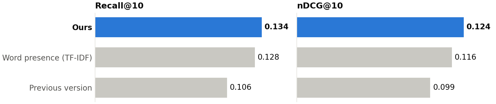
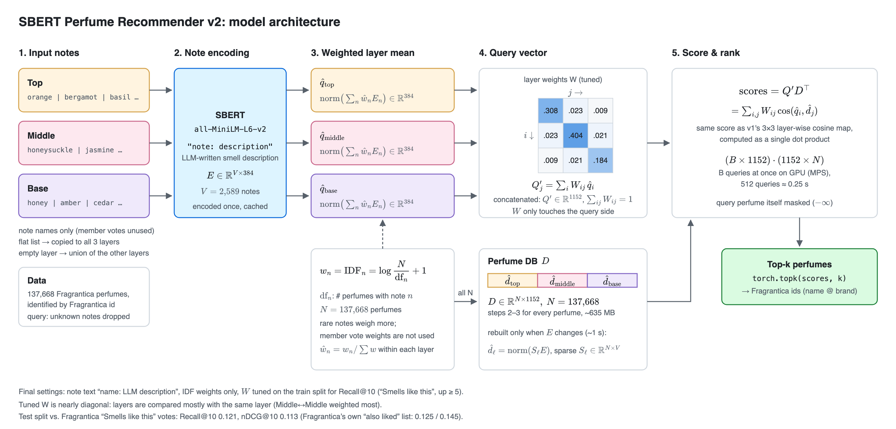
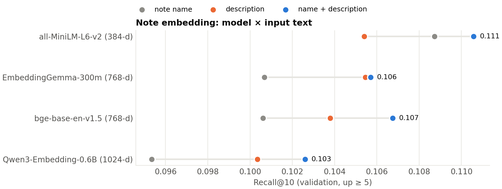
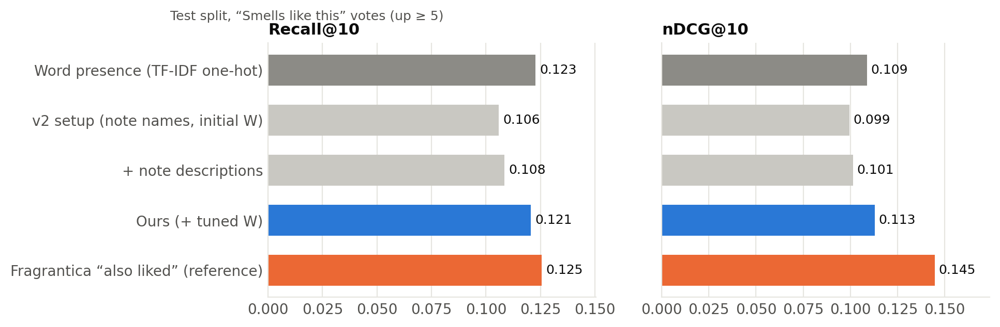
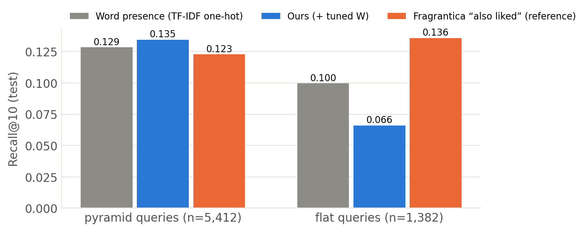

<p align="right">
  <a href="./README.md">🇺🇸 English</a> |
  <a href="./README.ko.md">🇰🇷 한국어</a>
</p>

# Perfume Recommendation with Note Embeddings

향수의 Top / Middle / Base 노트를 sentence embedding으로 바꿔서 향수 사이의 유사도를 측정하는 모델

### 핵심 결과


Fragrantica "smells like this" 투표 결과 데이터로 실행된 test에서 Embedding을 이용한 모델이 노트 단어의 유무 만을 판단한 모델보다 우수 

## 목차
1. [개요](#1-개요)
2. [설치 및 사용법](#2-설치-및-사용법)
3. [데이터셋](#3-데이터셋)
4. [아키텍처](#4-아키텍처)
5. [하이퍼파라미터 튜닝](#5-하이퍼파라미터-튜닝)
6. [결과](#6-결과)
7. [예시](#7-예시)
8. [한계](#8-한계)
9. [프로젝트 구조 및 실험 재현](#9-프로젝트-구조-및-실험-재현)
10. [라이선스 및 감사의 글](#10-라이선스-및-감사의-글)

---

## 1. 개요

### 배경
노트로 향수를 추천하는 가장 단순한 방법은 **word presence** 방식입니다. 노트 이름을 키워드로 보고, 두 향수가 노트 이름을 몇 개나 공유하는지로 점수를 매깁니다 (예: 노트 이름에 대한 TF-IDF cosine). 하지만 이 방식은 문자열이 정확히 같을 때만 같은 노트로 인식하기 때문에, 조향사라면 바로 알아챌 미묘한 관계를 놓칩니다.

- **같은 원료, 다른 이름**: `bergamot`, `sicilian bergamot`, `calabrian bergamot`, `bergamot rind`는 서로 무관한 키워드 네 개로 취급됩니다. 데이터에는 이런 변형이 수십 개씩 있습니다 (`oud`, `agarwood (oud)`, `indian oud`, …).
- **비슷한 향의 다른 원료**: `tonka bean`과 `coumarin`, `iso e super`와 `orbitone`은 향이 비슷하지만 이름에 겹치는 글자가 없습니다.
- **비슷한 철자, 다른 향**: `orange`(citrus)와 `orange blossom`(white floral)은 단어가 겹친다고 해서 가까우면 *안 됩니다*.

### 이 프로젝트에서 하는 것
노트마다 sentence embedding 벡터를 만들면, 이름이 달라도 향이 비슷한 노트끼리 가까이 놓입니다. 향수는 layer별로 노트 벡터의 가중 평균으로 표현하고, 두 향수를 layer끼리 비교합니다. Pyramid 없이 노트만 나열된 향수는 노트 전체 집합으로 비교합니다.

1. **Note encoding**: 서로 다른 노트를 `all-MiniLM-L6-v2`로 한 번씩만 인코딩합니다. 입력은 `"<노트>: <짧은 향 설명>"`입니다. 노트 이름만으로는 모델이 알 수 있는 정보가 너무 적어서, 노트마다 LLM이 쓴 향 설명을 붙였습니다.
2. **Layer embedding**: Top / Middle / Base 각각에서 노트 벡터를 IDF로 가중 평균합니다. musk처럼 어디에나 들어가는 노트보다 드물고 특징적인 노트가 더 큰 비중을 갖습니다.
3. **Layer-wise similarity**: 학습한 3×3 행렬 `W`로, 쿼리의 각 layer와 후보의 각 layer 사이 cosine similarity에 가중치를 줍니다.
4. **Flat 향수 처리**: 둘 중 하나라도 pyramid가 없으면 두 향수의 노트 전체 집합을 비교하고, 두 종류의 점수를 같은 척도로 맞추는 보정값 δ를 뺍니다.
5. **Search**: layer별 점수가 후보마다 내적 한 번으로 정리되기 때문에, DB는 `137,668 × 1,152` 행렬입니다 (노트 전체 집합 벡터용 `137,668 × 384` 행렬 추가).

최종 embedding 공간에서 가장 가까운 노트 (cosine similarity):

| 노트 | 가장 가까운 노트 |
|---|---|
| bergamot | white bergamot (0.92), bergamot blossom (0.90), sicilian bergamot (0.88), rind bergamot (0.88) |
| tonka bean | tonka (0.99), coumarin (0.89), kumbaru (0.81), sweet almond (0.72) |
| iso e super | orbitone (0.71), amberketal (0.64), transparent woods (0.64), amberwood (0.63) |
| orange blossom | citrus blossom (0.86), bitter orange blossom (0.85), african orange flower (0.83), french orange flower (0.83) |

---

## 2. 설치 및 사용법

### 저장소 클론

 패키지 버전은 `requirements.txt`에 고정되어 있습니다. (tested in Apple silicon Mac(MPS), Python 3.13)

```bash
git clone https://github.com/junminkim1111/perfume-note-embeddings.git
cd perfume-note-embeddings
pip install -r requirements.txt
```

### 데이터 준비
Kaggle API 토큰이 필요합니다 (kaggle.com → Settings → API).

```bash
pip install kaggle
kaggle datasets download ledecanteur/fragrantica-perfumes --unzip -p data/raw
python src/preprocess.py
```

`preprocess.py`는 `data/perfumes_clean.csv`, `data/smells_like.csv`, `data/also_liked.csv`를 만듭니다.

### 데모 실행
직접 입력한 노트 쿼리 하나와, DB에서 무작위로 고른 향수 하나로 추천 결과를 보여 줍니다.

```bash
python src/perfume_recommendation.py
```

처음 실행할 때 노트 2,589개를 인코딩해서 `cache/`에 저장합니다.

### Python에서 사용하기

```python
import sys; sys.path.insert(0, "src")
import pandas as pd, torch
from perfume_recommendation import Recommender
from functions import get_E, note_texts, get_doc_IDF_weights

device = torch.device("mps" if torch.backends.mps.is_available() else "cuda" if torch.cuda.is_available() else "cpu")
dataset = pd.read_csv("data/perfumes_clean.csv")
vocab = sorted(get_doc_IDF_weights(dataset))
E = get_E("minilm", "name+desc", note_texts(vocab, "name+desc"), device)   # 노트 embedding (캐시 사용)
rec = Recommender(dataset, None, device, E=E)                               # 기본값이 최종 설정

# 1) 직접 고른 노트로 검색 (빈 layer는 다른 layer의 노트로 채움)
scores, ids = rec.recommend_notes(top=["bergamot", "lemon"], middle=["lavender"], base=["tonka bean", "musk"], k=5)
rec.display("custom query", scores, ids)

# 2) DB에 있는 향수와 비슷한 향수 (Fragrantica id; 9828 = Creed Aventus)
scores, ids = rec.recommend_ids([9828], k=5)
rec.display("Aventus", scores[0], ids[0])
```

DB에 없는 노트는 embedding이 없으므로 경고를 띄우고 빼고 검색합니다.

---

## 3. 데이터셋

### 향수 데이터
[**Fragrantica Perfumes: Ratings, Notes, Votes & More**](https://www.kaggle.com/datasets/ledecanteur/fragrantica-perfumes) (Kaggle, 2026-09-20 업데이트, CC BY-NC-SA 4.0)
- 노트, 평점, 커뮤니티 투표가 포함된 향수 140,228개

노트마다 회원 투표로 매긴 0–100 가중치("이 노트가 얼마나 두드러지는가")가 있습니다. **모델은 이 가중치를 쓰지 않고** ([5.2](#52-노트-가중치-idf-vs-회원-투표)), 향수에 어떤 노트가 있는지만 봅니다.

`preprocess.py`는 원본을 향수당 한 행, 노트 layer 세 개로 바꿉니다.

| Fragrantica의 노트 표기 | 향수 수 | 변환 |
|---|---|---|
| Pyramid 전체 (Top / Middle / Base) | 98,371 | 그대로 사용 |
| Flat 목록만 (pyramid 없음) | 38,637 (27.6%) | 같은 노트를 세 layer에 모두 복사. 점수는 노트 전체 집합으로 계산 ([4.4](#44-flat-향수)) |
| 일부 layer가 빈 pyramid | 660 | 빈 layer를 나머지 layer 노트의 합집합으로 채움 |
| 노트 없음 | 2,560 | 제외 |

- 노트 이름은 소문자로 바꾸고 앞뒤 공백을 지웁니다 (2,592 → 2,589종).
- 이름이 같은 향수가 있어서, 향수는 Fragrantica `id`로 구분합니다.

### 평가 데이터: "Smells like this" 투표
Fragrantica의 향수 페이지마다 "This perfume reminds me of" 목록이 있고, 회원들이 두 향수가 비슷한 향인지 *agree / disagree*로 투표합니다. 이 투표를 정답으로 씁니다. 투표는 실제로 향을 맡아 본 사람들이 한 것이고, 모델은 노트 목록만 본다는 점이 다릅니다.

- 투표 수가 달린 (query, target) 쌍 740,672개 (`data/smells_like.csv`)
- `agree > disagree`이고 `agree ≥ 5`인 쌍을 **정답(positive)** 으로 봅니다. 정답의 gain은 `agree − disagree`입니다.
- 정답이 하나 이상 있는 향수 44,801개를 쿼리로 씁니다. 쿼리 id를 기준으로 시드를 고정해 **train 70% / validation 15% / test 15%** 로 나눕니다 (각각 31,235 / 6,772 / 6,794개).
- 분할과 상관없이 모든 향수는 검색 대상 DB에 남아 있습니다.
- 같은 페이지의 **"You might also like"** 목록(`similar.also_liked`, 투표 없음)은 참고용 비교 대상으로 씁니다. Fragrantica 자체 추천 알고리즘으로, 노트 외에 브랜드나 사용자들이 함께 본 기록 같은 신호도 사용합니다.

### 노트 설명
`data/note_descriptions.csv`에는 노트마다 짧은 향 설명이 하나씩 있습니다. LLM(Claude Opus 5.5)으로 작성했습니다.

- 향을 확신할 수 없는 노트 212개(8.2%)는 `UNKNOWN`으로 표시하고 노트 이름만 씁니다. 브랜드가 지어낸 판타지 노트(`powder from the moon` 등)나 정체가 불분명한 상품명이 여기에 해당합니다.

---

## 4. 아키텍처



### 4.1 Note encoding
서로 다른 노트 $n$ 2,589개를 한 번씩 인코딩합니다.

$$
E_n = \mathrm{MiniLM}\big(\, n \,{:}\, \mathrm{desc}(n) \,\big) \in \mathbb{R}^{384}
$$

**왜 설명을 붙이나요?**
노트 이름은 한두 단어뿐입니다. 이름만 넣으면 비교한 모든 모델(5.1)이 `sicilian bergamot`이 bergamot이라는 건 알지만, 이름이 비슷하다는 이유로 `iso e super`를 `eau de vie` 옆에, `hedione`을 `heliotrope` 옆에 둡니다. 짧은 향 설명을 붙이면 aroma chemical과 이름이 헷갈리는 노트가 제자리를 찾습니다 (`iso e super` → `orbitone`, `hedione` → `paradisone`, jasmine).

**왜 MiniLM인가요?**
비교한 네 모델 중 점수가 가장 좋았고(5.1), 크기도 가장 작습니다 (384차원).

### 4.2 Layer embedding (IDF 가중 평균)
향수 $p$의 layer $\ell \in \{\text{top}, \text{middle}, \text{base}\}$에 있는 노트 집합을 $N_\ell(p)$라고 하면:

$$
\mathrm{IDF}(n) = \log\frac{N}{\mathrm{df}(n)} + 1, \qquad
\hat w_n = \frac{\mathrm{IDF}(n)}{\sum_{m \in N_\ell(p)} \mathrm{IDF}(m)}, \qquad
\hat d_\ell(p) = \frac{\sum_{n \in N_\ell(p)} \hat w_n E_n}{\big\lVert \sum_{n \in N_\ell(p)} \hat w_n E_n \big\rVert}
$$

- $N$ = 향수 수 137,668개
- $\mathrm{df}(n)$ = 노트 $n$이 어느 layer에든 들어 있는 향수 수. 향수 하나는 한 번만 셉니다. 그래서 세 layer에 복사한 flat 향수도 세 번 세지 않습니다.

**왜 IDF인가요?**
`musk`는 아주 많은 향수에 들어 있어서 그 향수만의 특징을 거의 말해 주지 않습니다. musk를 공유하는 두 향수보다 드문 노트를 공유하는 두 향수가 실제로 비슷한 향일 가능성이 높습니다. IDF는 1.97(musk)부터 12.8(향수 하나에만 쓰인 노트)까지입니다.

### 4.3 Layer-wise similarity
쿼리 $q$와 후보 $d$를 대칭 $3 \times 3$ 가중치 행렬 $W$(원소 합 1)로 layer끼리 비교합니다.

$$
\mathrm{score}(q, d) = \sum_{i,j \in \{T, M, B\}} W_{ij}\, \cos\big(\hat q_i, \hat d_j\big)
$$

**왜 layer로 나누나요?**
노트 pyramid에는 시간이 담겨 있습니다. Top 노트는 뿌린 직후 몇 분, Base 노트는 마지막 잔향입니다. 같은 노트라도 다른 layer에 있으면 다른 향수가 됩니다.

**왜 대각선만이 아니라 행렬인가요?**
비대각 항이 있으면 한 향수가 heart 노트로 표기한 노트를 다른 향수가 base 노트로 표기했을 때도 서로 맞출 수 있습니다. 브랜드마다 layer 표기가 제각각이라 이런 경우가 흔합니다. 튜닝한 $W$(5.3)는 거의 대각 행렬이었고, Middle↔Middle의 비중이 가장 컸습니다.

### 4.4 Flat 향수
향수의 28%는 pyramid 없이 노트만 나열되어 있습니다. 이 노트를 세 layer에 복사해서 layer끼리 비교하면 잘 맞지 않습니다. flat 향수의 "top"에는 모든 노트가 들어 있지만 pyramid 향수의 top에는 몇 개뿐이라, flat 향수는 다른 flat 향수하고만 맞게 됩니다. 그래서 쿼리나 후보 중 하나라도 flat이면, 한쪽에 없는 layer 정보는 빼고 노트 전체 집합끼리 비교합니다.

$$
\mathrm{score}(q, d) =
\begin{cases}
\sum_{i,j} W_{ij}\, \cos\big(\hat q_i, \hat d_j\big) & q, d \text{ 모두 pyramid가 있을 때} \\
\cos\big(\hat u_q, \hat u_d\big) - \delta & \text{그 밖의 경우}
\end{cases}
$$

$\hat u$는 향수의 모든 노트를 IDF로 가중 평균해서 정규화한 벡터이고, $\delta = 0.125$입니다.

**왜 δ가 필요한가요?**
노트 전체 집합의 평균은 layer 하나의 평균보다 잡음이 적어서, 전체 집합 cosine이 layer별 점수보다 체계적으로 높게 나옵니다. 보정 없이 섞으면 pyramid 쿼리의 상위권을 flat 후보가 차지합니다 (validation Recall@10이 0.080까지 떨어짐). δ는 두 점수를 같은 척도로 맞추는 값으로, train에서 튜닝했습니다 (5.4). Flat 쿼리는 모든 후보가 전체 집합 점수를 쓰므로 δ가 순위에 영향을 주지 않습니다.

### 4.5 행렬곱 한 번으로 검색
모든 후보의 layer embedding을 미리 계산해 이어 붙여 둡니다: $D \in \mathbb{R}^{N \times 1152}$ (float32로 약 635MB). $W$는 쿼리 쪽에만 곱해지므로 점수는 내적 한 번입니다.

$$
Q'_j = \sum_i W_{ij}\, \hat q_i, \qquad Q' = [Q'_T, Q'_M, Q'_B] \in \mathbb{R}^{1152}, \qquad \mathrm{scores} = Q' D^\top
$$

- 쿼리 $B$개는 $(B \times 1152) \cdot (1152 \times N)$ 행렬곱 한 번과 `torch.topk`로 처리하고, 쿼리 향수 자신은 결과에서 뺍니다.
- 노트 전체 집합 벡터는 두 번째 행렬 $U \in \mathbb{R}^{N \times 384}$로 따로 두고, 배치마다 두 행렬곱을 계산해 flat 여부에 따라 고릅니다.

---

## 5. 하이퍼파라미터 튜닝

### 목적함수와 지표
모델은 쿼리마다 자기 자신을 뺀 상위 100개 목록을 냅니다. 쿼리별 지표는 다음과 같습니다.

| 지표 | 정의 |
|---|---|
| Recall@K | 상위 K개 안의 정답 수 / 그 쿼리의 전체 정답 수 (K = 5, 10, 20) |
| nDCG@10 | $\sum_{\text{상위 10개 안의 정답}} \frac{g}{\log_2(\text{순위}+1)}$ 를 가능한 최댓값으로 나눈 값, gain $g = \text{agree} - \text{disagree}$ |
| MRR | $1 / \text{첫 정답의 순위}$ (상위 100개 안에 없으면 0) |

- 점수는 쿼리 평균입니다.
- **튜닝 목적함수는 train 세트의 평균 Recall@10입니다.** 모든 정답을 똑같이 1개로 셉니다. nDCG는 정답 하나에 투표가 수천 개씩 달린 인기 향수 몇 개에 크게 좌우됩니다.
- 정상 동작 확인용 지표로 자기 자신 점수가 최댓값인지(self-Hit@1 ≈ 1), 상위 10개의 브랜드·성별 일치율과 노트 겹침을 같이 봅니다.

### 진행 방식
1. **train**에서 튜닝합니다: grid search, $W$는 Nelder-Mead.
2. **validation**으로 후보 중 하나를 고릅니다.
3. 마지막에 **test**를 한 번만 측정합니다 (6장).

임베딩 모델이나 입력 텍스트 같은 이산 선택은 나머지 설정을 고정하고 validation에서 비교했습니다. 차이가 0.00x 수준일 때는 쿼리 단위 paired bootstrap(2,000회)으로 유의성을 확인했습니다.

### 5.1 노트 embedding 모델과 입력 텍스트
모델 4개 × 입력 3가지(노트 이름, LLM 설명, `"이름: 설명"`)를 $W$와 노트 가중치를 고정한 채 validation에서 비교했습니다.



- 설명을 넣으면 모든 모델이 좋아지고, 큰 모델일수록 더 많이 오릅니다 (Qwen3 +0.007).
- **가장 작은 MiniLM이 전체 1위입니다** (`name + description`). 노트 이름만 넣었을 때도 네 모델 중 가장 좋습니다.
- MiniLM에서 이름만 쓸 때와 비교하면, 설명을 더했을 때 nDCG@10 +0.004(유의), Recall@10 +0.003(유의하지 않음)입니다 (validation, up ≥ 10).
- 비교한 모델:
  - `all-MiniLM-L6-v2`
  - `google/embeddinggemma-300m` (`STS` prompt 사용)
  - `BAAI/bge-base-en-v1.5`
  - `Qwen/Qwen3-Embedding-0.6B` (instruction: *"Given the name of a perfume note, represent how it smells"*)

### 5.2 노트 가중치: IDF vs. 회원 투표
데이터에는 노트마다 회원 투표로 매긴 두드러짐(0–100)이 있어서, 다음 식을 시험했습니다.

$w_n = \mathrm{IDF}(n)^{\gamma}\,\big(\alpha + (1-\alpha)\,v_n/100\big)$

- 아무도 투표하지 않은 향수는 $\alpha = 1$, 나머지는 $\alpha_{\min}$입니다.
- Grid: $\alpha_{\min} \in \{0, .25, .5, .75, 1\}$ × $\gamma \in \{0, .5, 1\}$

| 설정 (각자 $W$를 따로 튜닝) | Train R@10 | Val R@10 | Test R@10 |
|---|---|---|---|
| 투표 사용, IDF 없음 ($\alpha_{\min}$ = 0.5, $\gamma$ = 0) | 0.125 | 0.128 | 0.127 |
| **IDF만** ($\alpha_{\min}$ = 1, $\gamma$ = 1) | 0.121 | 0.119 | 0.125 |

- $W$를 고정했을 때는 투표가 IDF보다 확실히 좋았습니다.
- 그런데 설정마다 $W$를 따로 튜닝하면, test에서의 차이는 Recall@10 +0.0025로 줄어듭니다 (95% CI −0.001 ~ +0.006, 유의하지 않음).
- **최종 모델은 IDF만 씁니다.** 이 프로젝트의 목표는 노트 자체만으로 비슷한 향수를 찾는 것입니다. 노트 두드러짐 투표는 특정 향수에 대한 사람의 판단이라서, 이를 쓰면 사람의 지각이 모델에 우회해서 들어오게 됩니다. 그에 비해 얻는 이득은 실재한다고 보여 줄 수 없을 만큼 작았습니다.

### 5.3 Layer 가중치 W
$W$는 대칭이라 자유 원소가 6개입니다.
- softplus로 변환한 파라미터를 Nelder-Mead(adaptive, 225회 평가)로 최적화했습니다.
- 평가 한 번을 3초 정도로 유지하려고, 목적함수는 train 쿼리 중 고정된 무작위 10,000개로 계산했습니다.

```python
W = [[0.308, 0.023, 0.009],   # 쿼리 Top    vs. 후보 Top / Middle / Base
     [0.023, 0.404, 0.021],   # 쿼리 Middle
     [0.009, 0.021, 0.184]]   # 쿼리 Base   (원소 합 1)
```

- 튜닝한 $W$는 거의 대각 행렬입니다. 같은 layer끼리 비교하는 것이 거의 전부이고, Middle(heart) layer가 가장 중요합니다.
- $W$ 튜닝으로 test에서 Recall@10 +0.012, nDCG@10 +0.012가 올랐고, 둘 다 유의합니다 (6장).

### 5.4 Flat 향수: δ
튜닝한 $W$를 고정하고, train Recall@10으로 δ를 grid search했습니다.

| δ | 0 | 0.05 | 0.075 | 0.1 | **0.125** | 0.15 | 0.2 | 0.3 |
|---|---|---|---|---|---|---|---|---|
| Train R@10 | 0.083 | 0.115 | 0.126 | 0.134 | **0.136** | 0.135 | 0.132 | 0.130 |

Validation 결과:

| 점수 계산 방식 | R@10 | nDCG@10 | Flat 쿼리 R@10 | Pyramid 쿼리 R@10 |
|---|---|---|---|---|
| 모든 쌍을 layer별로 (이전) | 0.114 | 0.109 | 0.057 | 0.128 |
| 모든 쌍을 노트 전체 집합으로 | **0.130** | 0.119 | 0.123 | **0.132** |
| 혼합, δ = 0 | 0.080 | 0.069 | 0.123 | 0.070 |
| **혼합, δ = 0.125 (최종)** | 0.129 | **0.121** | 0.123 | 0.131 |

- Flat 쿼리 성능이 두 배가 되고 (0.057 → 0.123), pyramid 쿼리도 조금 오릅니다.
- 혼합 방식과 "모든 쌍을 노트 전체 집합으로"의 차이는 유의하지 않습니다 (Recall@10 −0.0005 [−0.004, +0.003], nDCG@10 +0.002 [−0.001, +0.004]). Pyramid 정보가 있는 곳에서는 그것을 쓰는 혼합 방식을 택했습니다.
- 혼합 방식에서 $W$를 다시 튜닝해도 변화가 없었습니다 (Recall@10 +0.0001).

**최종 설정**
- 임베딩: `all-MiniLM-L6-v2`, 입력 `"이름: 설명"`
- 노트 가중치: IDF
- $W$: 위의 튜닝 결과
- Flat 향수: 노트 전체 집합으로 비교, δ = 0.125

---

## 6. 결과

Test 세트 6,794개 쿼리, 정답 기준 `agree ≥ 5`로 측정했습니다.

**Word presence**는 파이프라인(IDF 가중치, layer, 튜닝한 $W$, train에서 따로 튜닝한 δ = 0.2의 flat 규칙)은 같고 노트를 embedding 대신 one-hot 벡터로 바꾼 모델입니다. 즉 노트 이름 TF-IDF cosine이고, embedding이 더하는 효과만 정확히 떼어 볼 수 있습니다.



| 방법 | R@5 | R@10 | R@20 | nDCG@10 | MRR |
|---|---|---|---|---|---|
| Random | 0.000 | 0.000 | 0.000 | 0.000 | 0.000 |
| Word presence (TF-IDF one-hot, 같은 파이프라인) | 0.108 | 0.128 | 0.149 | 0.116 | 0.154 |
| 이전 버전 설정: 노트 이름, 손으로 정한 W | 0.090 | 0.106 | 0.121 | 0.099 | 0.138 |
| + 노트 설명 | 0.092 | 0.108 | 0.124 | 0.101 | 0.139 |
| + 튜닝한 W | 0.103 | 0.121 | 0.140 | 0.113 | 0.152 |
| **Ours: + flat 향수 처리 (최종)** | **0.114** | **0.134** | **0.156** | **0.124** | **0.165** |
| *Fragrantica "also liked" (참고)* | *0.108* | *0.125* | *0.138* | *0.145* | *0.182* |

Test 세트 paired bootstrap (우리 모델 − 비교 대상, 95% CI):

| 비교 대상 | Recall@10 | nDCG@10 |
|---|---|---|
| Word presence | **+0.006 [+0.002, +0.009]** | **+0.009 [+0.006, +0.012]** |
| Flat 처리 전 (+ 튜닝한 W) | **+0.013 [+0.010, +0.016]** | **+0.011 [+0.009, +0.014]** |
| 이전 버전 설정 | **+0.028 [+0.024, +0.032]** | **+0.025 [+0.022, +0.029]** |

- **Word presence 대비**: 상위 10개 안에서 정답을 더 많이 찾고, 더 위에 놓습니다. 두 차이 모두 유의합니다.- **이전 버전 대비**: 같은 embedding 아이디어에 노트 이름과 손으로 정한 W를 쓴 설정을 새 데이터에서 돌린 것과 비교하면, 최종 모델은 Recall@10이 +26% 높습니다 (0.106 → 0.134). 노트 설명이 +0.002, W 튜닝이 +0.012, flat 향수 처리가 +0.013을 더했습니다.
- **Fragrantica 자체 추천**은 예상대로 nDCG/MRR이 가장 높습니다. 노트뿐 아니라 사용자 탐색 기록, 브랜드, 성별까지 쓰기 때문입니다. 상위 10개의 브랜드 일치율이 16%로, 우리 모델(4%)보다 훨씬 높습니다. Recall@10과 Recall@20에서는 노트만 쓰는 우리 모델이 더 높습니다 (0.134 vs 0.125, 0.156 vs 0.138).

### Flat vs. pyramid 향수


- Flat 향수 처리 전에는 layer 없이 노트만 나열된 flat 쿼리 1,382개가 약점이었습니다 (Recall@10 0.066).
- 노트 전체 집합으로 비교하면서 0.121로 올라 word presence(0.119)와 비슷해졌습니다.
- Pyramid 쿼리 5,412개도 조금 올랐습니다 (0.135 → 0.137, word presence 0.130).

---

## 7. 예시

### Embedding만 찾아내는 정답
Test 세트에서, 최종 모델은 상위 10위 안에 놓았지만 word presence는 30위 밖으로 밀어낸 정답들입니다. 두 향수가 *공유하지 않는* 노트를 보면, 대부분 같은 원료가 이름만 다르게 적힌 경우입니다. 키워드 매칭으로는 볼 수 없는 차이입니다.

| 쿼리 → 투표된 정답 ("agree" 수) | Ours | Word presence | 이름만 다른 노트 |
|---|---|---|---|
| Versus Pour Homme (In The Box) → **Versace Pour Homme** (209) | #10 | >100 | `blue hyacinth`/`hyacinth`, `crystal amber`/`amber`, `may rose`/`rose de mai`, `sage`/`clary sage`, `sicilian lemon`/`lemon` |
| Opium EDP 2009 → **Opium EDT 2009** (147) | #5 | >100 | `myrhh` (데이터 오타)/`myrrh`, `vanille`/`vanilla`, `mandarin orange`/`tangerine` |
| XS (2018) → **XS** (Rabanne) (190) | #3 | >100 | `geranium`/`bourbon geranium`, `juniper berries`/`juniper` |
| Van Py Rhum (Lorenzo Pazzaglia) → **X Xandal** (Aromatix × French Avenue) (174) | #4 | >100 | `agarwood (oud)`/`agarwood`, `tahitian vanilla`/`vanilla absolute` |

Test 세트의 모든 정답을 세어 보면, 두 모델이 서로 다르게 맞히는 경우는 일부입니다. 상대가 놓친 정답을 찾는 경우는 pyramid 쿼리와 flat 쿼리 모두에서 embedding 쪽이 더 많습니다.

| 상위 10개 안의 정답 | 둘 다 | Ours만 | Word presence만 |
|---|---|---|---|
| Pyramid 쿼리 | 1,466 | **302** | 221 |
| Flat 쿼리 | 253 | **67** | 50 |

### 추천 목록 예시
**Creed Aventus** (`bergamot, black currant, apple, pineapple, patchouli, birch, musk, oakmoss, ambroxan, …`)의 상위 5개:

| # | Ours |
|---|---|
| 1 | Mazajyy @ Zodiac |
| 2 | Niche 01 Extreme @ Zodiac |
| 3 | Athens @ OPUX |
| 4 | Bergamot Patchouli @ Loris Parfum |
| 5 | Veritas @ Lidl |

다섯 개 모두 Aventus의 노트 목록을 거의 그대로 가져온 dupe 향수로, 노트만 놓고 보면 맞는 답입니다. 반면 회원들이 Aventus와 비슷하다고 투표한 향수는 대부분 노트 목록이 다른 유명 향수들이라, 노트만 보는 모델로는 잘 찾지 못합니다 ([8장](#8-한계)).

---

## 8. 한계

- **Flat 향수**(28%)에는 layer 정보가 없어서, 이 향수들에 대해서는 모델이 노트 전체 집합 embedding일 뿐입니다. Pyramid 향수와 짝을 이룰 때는 보정값 δ 하나에 기대어 layer별 점수와 한 순위 안에서 비교됩니다.
- **노트는 향 그 자체가 아닙니다**: 회원들은 향을 맡고 투표하지만, 모델이 보는 노트 목록은 브랜드가 마케팅용으로 쓴 것입니다. 노트 외의 정보도 쓰는 Fragrantica 자체 추천조차 Recall@10이 0.125에 그칩니다. 이 정답 데이터에서는 어떤 방법이든 절대 점수가 낮습니다.
- **정답이 클론 쪽으로 치우쳐 있습니다**: 투표된 정답 중 상당수는 원본의 노트 목록을 거의 그대로 베낀 dupe나 flanker입니다. 이런 쌍은 노트 이름이 정확히 겹치는 것만으로도 찾을 수 있어서, 노트 의미를 더 잘 이해해도 지표에는 잘 드러나지 않습니다. 또 인기 향수일수록 투표가 많아 nDCG에서 비중이 큽니다.
- **LLM이 쓴 설명**: 노트 설명 2,589개는 전문가가 아니라 LLM이 생성했고, 모두 사람이 검수하지는 않았습니다. 212개 노트는 설명이 없습니다.
- **직접 입력하는 쿼리**에는 DB에 있는 노트만 쓸 수 있습니다. 없는 노트는 빠집니다.

---

## 9. 프로젝트 구조 및 실험 재현

```
src/
  perfume_recommendation.py      최종 추천 모델 (Recommender 클래스, 데모)
  preprocess.py                  Kaggle 원본 → data/*.csv
  functions.py                   노트 파싱, 향수 단위 IDF, 노트 가중치, 노트 embedding 로더 (get_E)
  optimize.py                    5.2–5.4 grid search + Nelder-Mead, `idf_only`, `flat`, `flat_w`, `flat_onehot` 모드
  evaluate.py                    지표, 데이터 분할, baseline; `baselines` 모드 = 6장
  v1(previous version)/          이전 버전: 추천 모델, 평가, W 튜닝, 노트북 (이전 데이터셋)
data/
  note_descriptions.csv          LLM 노트 설명 (커밋됨)
  fra_cleaned.csv                v1이 쓰는 이전 데이터셋
  raw/                           Kaggle 다운로드 (커밋 안 함)
docs/                            아키텍처 그림 (HTML 원본 + PNG), 그림
```

전체 실험을 처음부터 다시 돌리는 순서입니다.

```bash
python src/preprocess.py                 # 몇 초
python src/evaluate.py                   # 5단계 baseline, 약 1분
python src/optimize.py                   # 5.2–5.3 회원 투표 사용, 약 15분
python src/optimize.py idf_only          # 5.2–5.3 IDF만 사용 (최종 W), 약 12분
python src/optimize.py flat              # 5.4 flat 향수 δ, 약 4분
python src/optimize.py flat_w            # 5.4 혼합 vs 노트 전체 집합, W 재튜닝, 약 15분
python src/optimize.py flat_onehot       # word presence 기준선의 δ, 약 5분
python src/evaluate.py baselines         # 6장, 약 2분
```

> `cache/`에는 노트 embedding이 저장됩니다. `data/note_descriptions.csv`를 수정했다면 `cache/emb_*desc*.pt`를 지우고 다시 실행하세요.

### 이전 버전
- **v1**(`src/v1(previous version)/`)은 2024년 [Fragrantica 데이터셋](https://www.kaggle.com/datasets/olgagmiufana1/fragrantica-com-fragrance-dataset)(향수 24,063개)을 썼습니다.
- 노트 이름만 사용했고, $W$는 손으로 정했으며, 평가는 self-retrieval Hit@1로 했습니다.
- v1의 설계가 6장의 "이전 버전 설정" 행이고, 이 README는 **v2**를 설명합니다.

---

## 10. 라이선스 및 감사의 글

- **코드**: [MIT License](LICENSE).
- **데이터**: [Fragrantica Perfumes: Ratings, Notes, Votes & More](https://www.kaggle.com/datasets/ledecanteur/fragrantica-perfumes), **CC BY-NC-SA 4.0** (비상업적 이용, 출처 표시, 동일 조건 변경 허락). 이 레포의 파생 파일 `data/note_descriptions.csv`도 같은 라이선스를 따릅니다. 모든 향수 데이터의 출처는 [Fragrantica](https://www.fragrantica.com)입니다.
- **Embedding 모델**: [all-MiniLM-L6-v2](https://huggingface.co/sentence-transformers/all-MiniLM-L6-v2), [EmbeddingGemma](https://huggingface.co/google/embeddinggemma-300m), [bge-base-en-v1.5](https://huggingface.co/BAAI/bge-base-en-v1.5), [Qwen3-Embedding-0.6B](https://huggingface.co/Qwen/Qwen3-Embedding-0.6B)
