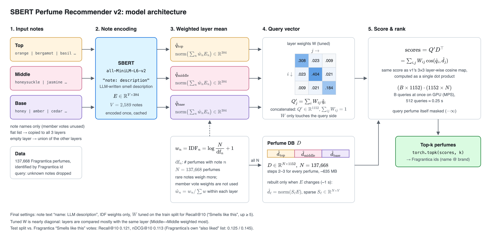

<p align="right">
  <a href="./README.md">🇺🇸 English</a> |
  <a href="./README.ko.md">🇰🇷 한국어</a>
</p>

<h1 align="center">Perfume Recommendation with Note Embeddings</h1>

<p align="center">향수의 Top / Middle / Base 노트를 sentence embedding으로 바꿔서 향수 사이의 유사도를 측정하는 모델. Fragrantica "smells like this" 투표 결과 데이터로 실행된 test에서 Embedding을 이용한 모델이 노트 단어의 유무 만을 판단한 모델보다 높은 성능을 보입니다.</p>

<p align="center"><b><a href="https://junminkim1111.github.io/Perfume-Note-Embeddings/ko.html">프로젝트 페이지</a></b>: 방법, 데이터셋, 튜닝, 결과, 예시, 한계</p>

**아키텍처**



## 목차
1. [설치 및 사용법](#1-설치-및-사용법)
2. [프로젝트 구조 및 실험 재현](#2-프로젝트-구조-및-실험-재현)
3. [라이선스 및 감사의 글](#3-라이선스-및-감사의-글)

---

## 1. 설치 및 사용법

### 저장소 클론

 패키지 버전은 `requirements.txt`에 고정되어 있습니다. (tested in Apple silicon Mac(MPS), Python 3.13)

```bash
git clone https://github.com/junminkim1111/perfume-note-embeddings.git
cd perfume-note-embeddings
pip install -r requirements.txt
```

### 데이터 준비
Kaggle API 토큰이 필요합니다 (kaggle.com → Settings → API).

```bash
pip install kaggle
kaggle datasets download ledecanteur/fragrantica-perfumes --unzip -p data/raw
python src/preprocess.py
```

`preprocess.py`는 `data/perfumes_clean.csv`, `data/smells_like.csv`, `data/also_liked.csv`를 만듭니다.

### 데모 실행
직접 입력한 노트 쿼리 하나와, DB에서 무작위로 고른 향수 하나로 추천 결과를 보여 줍니다.

```bash
python src/perfume_recommendation.py
```

처음 실행할 때 노트 2,589개를 인코딩해서 `cache/`에 저장합니다.

### Python에서 사용하기

```python
import sys; sys.path.insert(0, "src")
import pandas as pd, torch
from perfume_recommendation import Recommender
from functions import get_E, note_texts, get_doc_IDF_weights

device = torch.device("mps" if torch.backends.mps.is_available() else "cuda" if torch.cuda.is_available() else "cpu")
dataset = pd.read_csv("data/perfumes_clean.csv")
vocab = sorted(get_doc_IDF_weights(dataset))
E = get_E("minilm", "name+desc", note_texts(vocab, "name+desc"), device)   # 노트 embedding (캐시 사용)
rec = Recommender(dataset, None, device, E=E)                               # 기본값이 최종 설정

# 1) 직접 고른 노트로 검색 (빈 layer는 다른 layer의 노트로 채움)
scores, ids = rec.recommend_notes(top=["bergamot", "lemon"], middle=["lavender"], base=["tonka bean", "musk"], k=5)
rec.display("custom query", scores, ids)

# 2) DB에 있는 향수와 비슷한 향수 (Fragrantica id; 9828 = Creed Aventus)
scores, ids = rec.recommend_ids([9828], k=5)
rec.display("Aventus", scores[0], ids[0])
```

DB에 없는 노트는 embedding이 없으므로 경고를 띄우고 빼고 검색합니다.

---

## 2. 프로젝트 구조 및 실험 재현

```
src/
  perfume_recommendation.py      최종 추천 모델 (Recommender 클래스, 데모)
  preprocess.py                  Kaggle 원본 → data/*.csv
  functions.py                   노트 파싱, 향수 단위 IDF, 노트 가중치, 노트 embedding 로더 (get_E)
  optimize.py                    grid search + Nelder-Mead, `idf_only`, `flat`, `flat_w`, `flat_onehot` 모드
  evaluate.py                    지표, 데이터 분할, baseline; `baselines` 모드 = 최종 결과
  v1(previous version)/          이전 버전: 추천 모델, 평가, W 튜닝, 노트북 (이전 데이터셋)
data/
  note_descriptions.csv          LLM 노트 설명 (커밋됨)
  fra_cleaned.csv                v1이 쓰는 이전 데이터셋
  raw/                           Kaggle 다운로드 (커밋 안 함)
docs/                            프로젝트 페이지 (index.html, ko.html), 아키텍처 그림, 그림
```

전체 실험을 처음부터 다시 돌리는 순서입니다.

```bash
python src/preprocess.py                 # 몇 초
python src/evaluate.py                   # baseline, 약 1분
python src/optimize.py                   # 회원 투표 노트 가중치 + W, 약 15분
python src/optimize.py idf_only          # IDF만 사용 (최종 W), 약 12분
python src/optimize.py flat              # flat 향수 δ, 약 4분
python src/optimize.py flat_w            # 혼합 vs 노트 전체 집합, W 재튜닝, 약 15분
python src/optimize.py flat_onehot       # word presence 기준선의 δ, 약 5분
python src/evaluate.py baselines         # 최종 결과, 약 2분
```

> `cache/`에는 노트 embedding이 저장됩니다. `data/note_descriptions.csv`를 수정했다면 `cache/emb_*desc*.pt`를 지우고 다시 실행하세요.

### 이전 버전
- **v1**(`src/v1(previous version)/`)은 2024년 [Fragrantica 데이터셋](https://www.kaggle.com/datasets/olgagmiufana1/fragrantica-com-fragrance-dataset)(향수 24,063개)을 썼습니다.
- 노트 이름만 사용했고, W는 손으로 정했으며, 평가는 self-retrieval Hit@1로 했습니다.
- 이 README는 **v2**를 설명합니다.

---

## 3. 라이선스 및 감사의 글

- **코드**: [MIT License](LICENSE).
- **데이터**: [Fragrantica Perfumes: Ratings, Notes, Votes & More](https://www.kaggle.com/datasets/ledecanteur/fragrantica-perfumes), **CC BY-NC-SA 4.0** (비상업적 이용, 출처 표시, 동일 조건 변경 허락). 이 레포의 파생 파일 `data/note_descriptions.csv`도 같은 라이선스를 따릅니다. 모든 향수 데이터의 출처는 [Fragrantica](https://www.fragrantica.com)입니다.
- **Embedding 모델**: [all-MiniLM-L6-v2](https://huggingface.co/sentence-transformers/all-MiniLM-L6-v2), [EmbeddingGemma](https://huggingface.co/google/embeddinggemma-300m), [bge-base-en-v1.5](https://huggingface.co/BAAI/bge-base-en-v1.5), [Qwen3-Embedding-0.6B](https://huggingface.co/Qwen/Qwen3-Embedding-0.6B)
