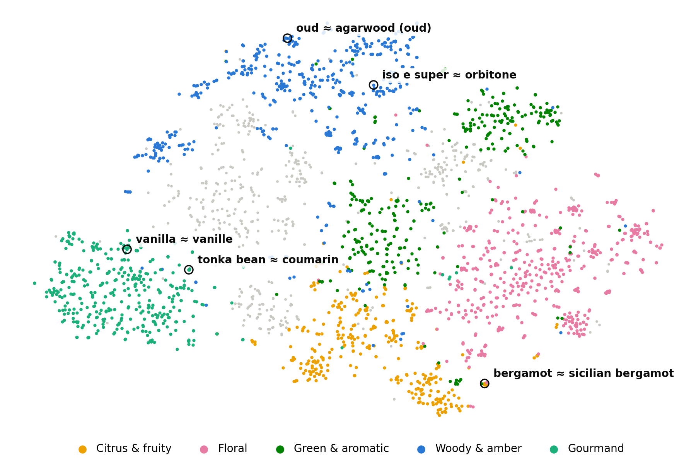

<p align="right">
  <a href="./README.md">🇺🇸 English</a> |
  <a href="./README.ko.md">🇰🇷 한국어</a>
</p>

<h1 align="center">Perfume Recommendation with Note Embeddings</h1>

<p align="center">A model that measures how similar two perfumes are by turning their Top / Middle / Base notes into sentence embeddings</p>

<p align="center"></p>

<p align="center">On a test split built from Fragrantica's "Smells like this" votes, the embedding model outperforms a model that only checks which note words are present</p>

## Contents
1. [Overview](#1-overview)
2. [Installation & usage](#2-installation--usage)
3. [Datasets](#3-datasets)
4. [Architecture](#4-architecture)
5. [Hyperparameter tuning](#5-hyperparameter-tuning)
6. [Results](#6-results)
7. [Examples](#7-examples)
8. [Limitations](#8-limitations)
9. [Project structure & reproducing the experiments](#9-project-structure--reproducing-the-experiments)
10. [License & acknowledgements](#10-license--acknowledgements)

---

## 1. Overview

### Background
The simplest way to recommend a perfume from its notes is **word presence**: treat each note name as a keyword and score two perfumes by how many note names they share (e.g. TF-IDF cosine over note names). That model only sees exact string matches, so it misses the subtle relations a perfumer would see:

- **Same material, different name.** `bergamot`, `sicilian bergamot`, `calabrian bergamot` and `bergamot rind` are four unrelated keywords. The dataset has dozens of such variants (`oud`, `agarwood (oud)`, `indian oud`, …).
- **Related materials.** `tonka bean` and `coumarin`, or `iso e super` and `orbitone`, smell alike but share no characters.
- **Similar spelling, different smell.** `orange` (citrus) and `orange blossom` (white floral) should *not* be close just because they share a word.

### What this project does
Each note is turned into a vector by a sentence-embedding model, so similar-smelling notes end up close together even when their names differ. A perfume is then represented layer by layer as a weighted average of its note vectors, and perfumes are compared layer against layer. Perfumes that list their notes without a pyramid are compared on their whole note set instead.

1. **Note encoding** – every distinct note is encoded once by `all-MiniLM-L6-v2` from the text `"<note>: <short smell description>"`. The descriptions (one per note) were written by an LLM, because the bare note name gives the model too little to work with.
2. **Layer embedding** – for each of Top / Middle / Base, an IDF-weighted average of the note vectors, so rare, distinctive notes count more than ubiquitous ones like musk.
3. **Layer-wise similarity** – a learned 3×3 matrix `W` weights the cosine similarity between every query layer and every candidate layer.
4. **Flat perfumes** – if either perfume lists its notes without a pyramid, the two are compared on their whole note sets, minus a tuned offset δ that puts both kinds of score on one scale.
5. **Search** – the layer-wise score collapses into one dot product per candidate, so the database is a `137,668 × 1,152` matrix (plus a `137,668 × 384` matrix of whole-note-set vectors).

Nearest notes in the final embedding space (cosine similarity):

| Note | Nearest notes |
|---|---|
| bergamot | white bergamot (0.92), bergamot blossom (0.90), sicilian bergamot (0.88), rind bergamot (0.88) |
| tonka bean | tonka (0.99), coumarin (0.89), kumbaru (0.81), sweet almond (0.72) |
| iso e super | orbitone (0.71), amberketal (0.64), transparent woods (0.64), amberwood (0.63) |
| orange blossom | citrus blossom (0.86), bitter orange blossom (0.85), african orange flower (0.83), french orange flower (0.83) |

---

## 2. Installation & usage

### Clone the repository

Package versions are pinned in `requirements.txt`. (Tested on an Apple-silicon Mac (MPS) with Python 3.13.)

```bash
git clone https://github.com/junminkim1111/perfume-note-embeddings.git
cd perfume-note-embeddings
pip install -r requirements.txt
```

### Prepare the data
Needs a Kaggle API token (kaggle.com → Settings → API).

```bash
pip install kaggle
kaggle datasets download ledecanteur/fragrantica-perfumes --unzip -p data/raw
python src/preprocess.py
```

`preprocess.py` writes `data/perfumes_clean.csv`, `data/smells_like.csv` and `data/also_liked.csv`.

### Run the demo
Shows recommendations for a custom note query and for a random perfume from the database.

```bash
python src/perfume_recommendation.py
```

The first run encodes the 2,589 notes and caches them in `cache/`.

### Use from Python

```python
import sys; sys.path.insert(0, "src")
import pandas as pd, torch
from perfume_recommendation import Recommender
from functions import get_E, note_texts, get_doc_IDF_weights

device = torch.device("mps" if torch.backends.mps.is_available() else "cuda" if torch.cuda.is_available() else "cpu")
dataset = pd.read_csv("data/perfumes_clean.csv")
vocab = sorted(get_doc_IDF_weights(dataset))
E = get_E("minilm", "name+desc", note_texts(vocab, "name+desc"), device)   # note embeddings (cached)
rec = Recommender(dataset, None, device, E=E)                               # final settings are the defaults

# 1) your own notes (an empty layer is filled with the other layers' notes)
scores, ids = rec.recommend_notes(top=["bergamot", "lemon"], middle=["lavender"], base=["tonka bean", "musk"], k=5)
rec.display("custom query", scores, ids)

# 2) perfumes similar to one in the database (Fragrantica id; 9828 = Creed Aventus)
scores, ids = rec.recommend_ids([9828], k=5)
rec.display("Aventus", scores[0], ids[0])
```

Notes that do not occur in the database are dropped with a warning (there is no embedding for them).

---

## 3. Datasets

### Perfumes
[**Fragrantica Perfumes: Ratings, Notes, Votes & More**](https://www.kaggle.com/datasets/ledecanteur/fragrantica-perfumes) (Kaggle, last updated 2026-09-20, CC BY-NC-SA 4.0): 140,228 perfumes with notes, ratings and community votes.

Each note comes with a 0–100 weight from member votes ("how prominent is this note"). **The model does not use these weights** ([§5.2](#52-note-weights-idf-vs-member-votes)); it only uses which notes a perfume lists.

`preprocess.py` converts the dump into one row per perfume with three note layers:

| Notes as listed on Fragrantica | Perfumes | Conversion |
|---|---|---|
| Full pyramid (Top / Middle / Base) | 98,371 | kept as is |
| Flat list only (no pyramid) | 38,637 (27.6%) | the same notes are copied into all three layers; scoring uses the whole note set ([§4.4](#44-flat-perfumes)) |
| Pyramid with an empty layer | 660 | the empty layer gets the union of the other layers |
| No notes | 2,560 | dropped |

Note names are lower-cased and stripped (2,592 → 2,589 distinct notes). Perfumes are identified by their Fragrantica `id`, since names are not unique.

### Evaluation data: "Smells like this" votes
Every Fragrantica perfume page has a "This perfume reminds me of" list, where members vote *agree / disagree* on whether two perfumes smell alike. These votes are the ground truth. They come from people who smelled the perfumes, while the model only sees note lists.

- 740,672 (query, target) pairs with vote counts (`data/smells_like.csv`).
- A pair is a **positive** if `agree > disagree` and `agree ≥ 5`. The gain of a positive is `agree − disagree`.
- 44,801 perfumes have at least one positive and are used as queries. They are split by query id, with a fixed seed, into **train 70% / validation 15% / test 15%** (31,235 / 6,772 / 6,794 queries). Every perfume stays in the searchable database whatever its split.
- The page's algorithmic **"You might also like"** list (`similar.also_liked`, no votes) is used as a reference point. It is Fragrantica's own recommender, which also uses signals beyond notes, such as brand and what users browse together.

### Note descriptions
`data/note_descriptions.csv` has one short smell description per note, written by an LLM (Claude Opus 5.5).

212 notes (8.2%) whose smell could not be identified with confidence (brand fantasy notes such as `powder from the moon`, unclear trade names) are marked `UNKNOWN` and fall back to the bare note name.

---

## 4. Architecture


### 4.1 Note encoding
Every distinct note $n$ (2,589 of them) is encoded once:

$$
E_n = \mathrm{MiniLM}\big(\, n \,{:}\, \mathrm{desc}(n) \,\big) \in \mathbb{R}^{384}
$$

*Why a description?* A note name is one to three words. With the name alone, every model we tried (§5.1) knows that `sicilian bergamot` is a bergamot, but places `iso e super` next to `eau de vie` and `hedione` next to `heliotrope`, because those names look alike. A short smell description puts aroma chemicals and look-alike names in the right place (`iso e super` → `orbitone`, `hedione` → `paradisone`, jasmine).

*Why MiniLM?* It scored best of the four models compared (§5.1), and it is also the smallest (384-d).

### 4.2 Layer embedding (IDF-weighted mean)
For perfume $p$ and layer $\ell \in \{\text{top}, \text{middle}, \text{base}\}$ with notes $N_\ell(p)$:

$$
\mathrm{IDF}(n) = \log\frac{N}{\mathrm{df}(n)} + 1, \qquad
\hat w_n = \frac{\mathrm{IDF}(n)}{\sum_{m \in N_\ell(p)} \mathrm{IDF}(m)}, \qquad
\hat d_\ell(p) = \frac{\sum_{n \in N_\ell(p)} \hat w_n E_n}{\big\lVert \sum_{n \in N_\ell(p)} \hat w_n E_n \big\rVert}
$$

$N$ = 137,668 perfumes, $\mathrm{df}(n)$ = number of perfumes that list note $n$ in any layer (each perfume counts once, so a flat perfume copied into three layers does not count three times).

*Why IDF?* `musk` appears in a large share of all perfumes and says little about what makes a perfume distinctive. Two perfumes that share a rare note are more likely to smell alike than two that share musk. IDF ranges from 1.97 (musk) to 12.8 (notes used by a single perfume).

### 4.3 Layer-wise similarity
A query $q$ and a candidate $d$ are compared layer against layer with a symmetric $3 \times 3$ weight matrix $W$ (entries sum to 1):

$$
\mathrm{score}(q, d) = \sum_{i,j \in \{T, M, B\}} W_{ij}\, \cos\big(\hat q_i, \hat d_j\big)
$$

*Why layers?* A note pyramid encodes time: top notes are the first minutes, base notes the dry-down. The same notes in a different layer make a different perfume.

*Why a matrix and not just the diagonal?* The off-diagonal terms let a note that one perfume lists as a heart note match the same note listed as a base note in another, which is common because brands assign layers inconsistently. The tuned $W$ (§5.3) turned out to be nearly diagonal, with Middle↔Middle weighted most.

### 4.4 Flat perfumes
28% of perfumes list their notes without a pyramid. Copying those notes into all three layers and comparing layer by layer does not work: a flat perfume's "top" holds every note while a pyramid's top holds only a few, so flat perfumes end up matching only each other. So whenever the query or the candidate is flat, the layer information that one side lacks is left out, and the two whole note sets are compared:

$$
\mathrm{score}(q, d) =
\begin{cases}
\sum_{i,j} W_{ij}\, \cos\big(\hat q_i, \hat d_j\big) & \text{both } q \text{ and } d \text{ have a pyramid} \\
\cos\big(\hat u_q, \hat u_d\big) - \delta & \text{otherwise}
\end{cases}
$$

$\hat u$ is the IDF-weighted mean over all of a perfume's notes, normalized, and $\delta = 0.125$.

*Why δ?* A whole note set is a less noisy average than a single layer, so whole-set cosines run systematically higher than layer-wise scores. Without the offset, flat candidates crowd out pyramid candidates for every pyramid query (validation Recall@10 falls to 0.080). δ puts the two kinds of score on one scale and is tuned on train (§5.4). For a flat query every candidate uses the whole-set score, so δ does not change its ranking.

### 4.5 Search as one matrix product
All candidate layers are precomputed and concatenated, $D \in \mathbb{R}^{N \times 1152}$ ($\approx$ 635 MB in float32). Because $W$ only touches the query side, the score is a single dot product:

$$
Q'_j = \sum_i W_{ij}\, \hat q_i, \qquad Q' = [Q'_T, Q'_M, Q'_B] \in \mathbb{R}^{1152}, \qquad \mathrm{scores} = Q' D^\top
$$

A batch of $B$ queries is one $(B \times 1152) \cdot (1152 \times N)$ product followed by `torch.topk`; the query perfume itself is masked out. Whole-note-set vectors are a second matrix $U \in \mathbb{R}^{N \times 384}$; for a batch, both products are computed and combined with the flat mask.

---

## 5. Hyperparameter tuning

### Objective and metrics
For each query the model returns its top-100 list (the query itself excluded). Per query:

| Metric | Definition |
|---|---|
| Recall@K | positives in the top K / all positives of the query (K = 5, 10, 20) |
| nDCG@10 | $\sum_{\text{hits in top 10}} \frac{g}{\log_2(\text{rank}+1)}$ divided by the best achievable value, gain $g = \text{agree} - \text{disagree}$ |
| MRR | $1 / \text{rank of the first positive}$ (0 if none in the top 100) |

Scores are averaged over queries. **The tuning objective is mean Recall@10 on the train split.** It counts every voted match equally, while nDCG is dominated by a few very popular perfumes whose matches have thousands of votes. Sanity metrics: the query's self-score is the maximum (self-Hit@1 ≈ 1), and brand / gender agreement and note overlap of the top 10.

### Protocol
1. Tune on **train**: grid searches, and Nelder-Mead for $W$.
2. Choose between candidates on **validation**.
3. Measure **test** once at the end (§6).

Discrete choices (embedding model, input text) were compared on validation with the other settings fixed. Differences of a few thousandths were checked with a paired bootstrap over queries (2,000 resamples).

### 5.1 Note embedding model and input text
Four models × three input texts: the note name, the LLM description, and `"name: description"`. Measured on validation with $W$ and the note weights fixed.


- The description helps every model; the larger models gain most (Qwen3 +0.007).
- **The smallest model, MiniLM, is best overall** (with `name + description`), and best of the four with note names alone. Against MiniLM with names only, adding the description gives +0.004 nDCG@10 (significant) and +0.003 Recall@10 (not significant; validation, up ≥ 10).
- The models listed in the figure: `all-MiniLM-L6-v2`, `google/embeddinggemma-300m` (with its `STS` prompt), `BAAI/bge-base-en-v1.5`, `Qwen/Qwen3-Embedding-0.6B` (with the instruction *"Given the name of a perfume note, represent how it smells"*).

### 5.2 Note weights: IDF vs. member votes
The dataset has a member-voted prominence for each note (0–100), so we tried
$w_n = \mathrm{IDF}(n)^{\gamma}\,\big(\alpha + (1-\alpha)\,v_n/100\big)$, with $\alpha = 1$ for perfumes nobody voted on and $\alpha_{\min}$ otherwise, over the grid $\alpha_{\min} \in \{0, .25, .5, .75, 1\}$ × $\gamma \in \{0, .5, 1\}$.

| Setting (each with its own tuned W) | Train R@10 | Val R@10 | Test R@10 |
|---|---|---|---|
| Votes, no IDF ($\alpha_{\min}$ = 0.5, $\gamma$ = 0) | 0.125 | 0.128 | 0.127 |
| **IDF only** ($\alpha_{\min}$ = 1, $\gamma$ = 1) | 0.121 | 0.119 | 0.125 |

With a fixed $W$, votes beat IDF clearly. Once each setting gets its own tuned $W$, the gap on test is +0.0025 Recall@10 (95% CI −0.001 to +0.006, not significant). **The final model uses IDF only.** The goal is to find similar perfumes from the notes themselves. Member prominence votes are human judgements about the specific perfume, so using them would let people's perception into the model through the back door, for a gain we could not show to be real.

### 5.3 Layer weights W
$W$ has six free entries (symmetric). They are optimized as softplus-transformed parameters with Nelder-Mead (adaptive, 225 evaluations). To keep each evaluation at about 3 s, the objective uses a fixed random sample of 10,000 train queries.

```python
W = [[0.308, 0.023, 0.009],   # query Top    vs. candidate Top / Middle / Base
     [0.023, 0.404, 0.021],   # query Middle
     [0.009, 0.021, 0.184]]   # query Base   (entries sum to 1)
```

The tuned $W$ is nearly diagonal: layers are compared with the same layer, and the middle (heart) layer matters most. Tuning $W$ adds +0.012 Recall@10 and +0.012 nDCG@10 on test, both significant (§6).

### 5.4 Flat perfumes: δ
δ is grid-searched on train Recall@10 with the tuned $W$ fixed:

| δ | 0 | 0.05 | 0.075 | 0.1 | **0.125** | 0.15 | 0.2 | 0.3 |
|---|---|---|---|---|---|---|---|---|
| Train R@10 | 0.083 | 0.115 | 0.126 | 0.134 | **0.136** | 0.135 | 0.132 | 0.130 |

On validation:

| Scoring | R@10 | nDCG@10 | Flat queries R@10 | Pyramid queries R@10 |
|---|---|---|---|---|
| Layer-wise for every pair (before) | 0.114 | 0.109 | 0.057 | 0.128 |
| Whole note set for every pair | **0.130** | 0.119 | 0.123 | **0.132** |
| Hybrid, δ = 0 | 0.080 | 0.069 | 0.123 | 0.070 |
| **Hybrid, δ = 0.125 (final)** | 0.129 | **0.121** | 0.123 | 0.131 |

- Flat queries double (0.057 → 0.123), and pyramid queries improve slightly.
- Hybrid vs. whole note set for every pair is not a significant difference (Recall@10 −0.0005 [−0.004, +0.003], nDCG@10 +0.002 [−0.001, +0.004]). We keep the hybrid because it uses the pyramid wherever one exists.
- Re-tuning $W$ under the hybrid rule changed nothing (+0.0001 Recall@10).

**Final settings**: `all-MiniLM-L6-v2` on `"name: description"`, IDF note weights, tuned $W$ above, whole-note-set comparison for flat perfumes with δ = 0.125.

---

## 6. Results

Test split, 6,794 queries, positives with `agree ≥ 5`. **Word presence** is the same pipeline (IDF weights, layers, tuned $W$, the flat rule with its own δ = 0.2 tuned on train) with every note as a one-hot vector instead of an embedding, i.e. TF-IDF cosine over note names. It isolates exactly what the embedding adds.


| Method | R@5 | R@10 | R@20 | nDCG@10 | MRR |
|---|---|---|---|---|---|
| Random | 0.000 | 0.000 | 0.000 | 0.000 | 0.000 |
| Word presence (TF-IDF one-hot, same pipeline) | 0.108 | 0.128 | 0.149 | 0.116 | 0.154 |
| Previous version's setup: note names, hand-set W | 0.090 | 0.106 | 0.121 | 0.099 | 0.138 |
| + note descriptions | 0.092 | 0.108 | 0.124 | 0.101 | 0.139 |
| + tuned W | 0.103 | 0.121 | 0.140 | 0.113 | 0.152 |
| **Ours: + flat handling (final)** | **0.114** | **0.134** | **0.156** | **0.124** | **0.165** |
| *Fragrantica "also liked" (reference)* | *0.108* | *0.125* | *0.138* | *0.145* | *0.182* |

Paired bootstrap on test (ours minus the other, 95% CI):

| vs. | Recall@10 | nDCG@10 |
|---|---|---|
| Word presence | **+0.006 [+0.002, +0.009]** | **+0.009 [+0.006, +0.012]** |
| Before flat handling (+ tuned W) | **+0.013 [+0.010, +0.016]** | **+0.011 [+0.009, +0.014]** |
| Previous version's setup | **+0.028 [+0.024, +0.032]** | **+0.025 [+0.022, +0.029]** |

- **Against word presence**, the embedding finds more voted matches in the top 10 and ranks them higher; both differences are significant.- **Against the previous version** (the same embedding idea with note names and a hand-set W, run on the new data), the final model is +26% Recall@10 (0.106 → 0.134). Descriptions add +0.002, tuning W +0.012, and flat handling +0.013.
- Fragrantica's own list ranks best on nDCG/MRR, as expected: it is built from browsing behaviour, brand and gender as well as notes. Its brand agreement in the top 10 is 16% versus 4% for ours. On Recall@10 and Recall@20 the note-only model is ahead of it (0.134 vs 0.125, 0.156 vs 0.138).

### Flat vs. pyramid perfumes


Before flat handling, the 1,382 flat queries (notes listed without layers) were the weak spot: Recall@10 0.066. Comparing them on whole note sets brings them to 0.121, on par with word presence (0.119), while the 5,412 pyramid queries also improve slightly (0.135 → 0.137, word presence 0.130).

---

## 7. Examples

### Matches only the embedding finds
On the test split, voted matches that the final model ranks in its top 10 while word presence ranks them below 30. The notes the two perfumes do *not* share are mostly the same materials under different names, which a keyword match cannot see:

| Query → voted match ("agree" votes) | Ours | Word presence | Notes that differ only by name |
|---|---|---|---|
| Versus Pour Homme (In The Box) → **Versace Pour Homme** (209) | #10 | >100 | `blue hyacinth`/`hyacinth`, `crystal amber`/`amber`, `may rose`/`rose de mai`, `sage`/`clary sage`, `sicilian lemon`/`lemon` |
| Opium EDP 2009 → **Opium EDT 2009** (147) | #5 | >100 | `myrhh` (typo in the data)/`myrrh`, `vanille`/`vanilla`, `mandarin orange`/`tangerine` |
| XS (2018) → **XS** (Rabanne) (190) | #3 | >100 | `geranium`/`bourbon geranium`, `juniper berries`/`juniper` |
| Van Py Rhum (Lorenzo Pazzaglia) → **X Xandal** (Aromatix × French Avenue) (174) | #4 | >100 | `agarwood (oud)`/`agarwood`, `tahitian vanilla`/`vanilla absolute` |

Counting every voted match in the test split, the two models disagree on a minority of hits, and the embedding finds more of the ones the other misses, on both pyramid and flat queries:

| Voted matches in the top 10 | Both | Ours only | Word presence only |
|---|---|---|---|
| Pyramid queries | 1,466 | **302** | 221 |
| Flat queries | 253 | **67** | 50 |

### A typical recommendation list
Top 5 for **Creed Aventus** (`bergamot, black currant, apple, pineapple, patchouli, birch, musk, oakmoss, ambroxan, …`):

| # | Ours |
|---|---|
| 1 | Mazajyy @ Zodiac |
| 2 | Niche 01 Extreme @ Zodiac |
| 3 | Athens @ OPUX |
| 4 | Bergamot Patchouli @ Loris Parfum |
| 5 | Veritas @ Lidl |

All five are Aventus-inspired dupes that copy its note list almost verbatim, which is the right answer from the notes' point of view. The perfumes members vote as smelling like Aventus are mostly other popular perfumes with different note lists, which a note-only model rarely retrieves ([§8](#8-limitations)).

---

## 8. Limitations

- **Flat perfumes** (28%) have no layer information, so for them the model is a plain whole-note-set embedding. Their pairs with pyramid perfumes share one ranking with layer-wise scores only through the single offset δ.
- **Notes are not the smell.** Members vote after smelling the perfumes; the model sees a note list that brands write for marketing. Fragrantica's own recommender, which uses more than notes, reaches only Recall@10 0.125 itself; absolute scores on these labels are low for any method.
- **The labels favour clones.** Many voted matches are dupes or flankers that copy the original's note list almost exactly. Exact name overlap already finds these, which limits how much better understanding of notes can show up in the metrics. Popular perfumes also have more votes, so they weigh more in nDCG.
- **LLM-written descriptions.** The 2,589 note descriptions were generated, not written by experts, and have not all been checked by hand. 212 notes have no description.
- **Custom queries** can only use notes that occur in the database. Unknown notes are dropped.

---

## 9. Project structure & reproducing the experiments

```
src/
  perfume_recommendation.py      final recommender (Recommender class, demo)
  preprocess.py                  raw Kaggle dump → data/*.csv
  functions.py                   note parsing, per-perfume IDF, note weights, note embedding loader (get_E)
  optimize.py                    §5.2–5.4 grid search + Nelder-Mead; `idf_only`, `flat`, `flat_w`, `flat_onehot` modes
  evaluate.py                    metrics, splits, baselines; `baselines` mode = §6
  v1(previous version)/          previous version: recommender, evaluation, W tuning, notebook (old dataset)
data/
  note_descriptions.csv          LLM note descriptions (committed)
  fra_cleaned.csv                old dataset used by v1
  raw/                           Kaggle download (not committed)
docs/                            architecture figure (HTML source + PNG), figures
```

Re-running everything, in order:

```bash
python src/preprocess.py                 # seconds
python src/evaluate.py                   # step-5 baselines, ~1 min
python src/optimize.py                   # §5.2–5.3 with member votes, ~15 min
python src/optimize.py idf_only          # §5.2–5.3 IDF only (final W), ~12 min
python src/optimize.py flat              # §5.4 δ for flat perfumes, ~4 min
python src/optimize.py flat_w            # §5.4 hybrid vs whole note set, W re-tune, ~15 min
python src/optimize.py flat_onehot       # δ for the word-presence baseline, ~5 min
python src/evaluate.py baselines         # §6, ~2 min
```

`cache/` holds note embeddings; delete `cache/emb_*desc*.pt` after editing `data/note_descriptions.csv`.

### Previous version
- **v1** (`src/v1(previous version)/`) used the 2024 [Fragrantica dataset](https://www.kaggle.com/datasets/olgagmiufana1/fragrantica-com-fragrance-dataset) (24,063 perfumes) with note names only, a hand-set $W$, and self-retrieval Hit@1 as the metric. Its design is the "previous version's setup" row in §6; this README describes **v2**.

---

## 10. License & acknowledgements

- Code: [MIT License](LICENSE).
- Data: [Fragrantica Perfumes: Ratings, Notes, Votes & More](https://www.kaggle.com/datasets/ledecanteur/fragrantica-perfumes), licensed **CC BY-NC-SA 4.0** (non-commercial, attribution, share-alike). The derived file `data/note_descriptions.csv` is shared under the same license. All perfume data originates from [Fragrantica](https://www.fragrantica.com).
- Embedding models: [all-MiniLM-L6-v2](https://huggingface.co/sentence-transformers/all-MiniLM-L6-v2), [EmbeddingGemma](https://huggingface.co/google/embeddinggemma-300m), [bge-base-en-v1.5](https://huggingface.co/BAAI/bge-base-en-v1.5), [Qwen3-Embedding-0.6B](https://huggingface.co/Qwen/Qwen3-Embedding-0.6B).
